# RAG, from A to Z

## A. The problem this project solves

Imagine you have appliance manuals, telemetry pipeline notes, and support policies.
A user asks: “What happens if the gateway loses its internet connection?” The model
needs your particular documents to answer accurately. This project retrieves the
relevant evidence before asking the model to produce an answer.

RAG means **Retrieval-Augmented Generation**. It does not train the LLM on your
files. It selects information and includes it in the model input at query time.
The demo answers questions about a fictional industrial-kitchen telemetry platform.

## B. The two pipelines

Indexing happens when a document is added or changed. Retrieval/generation happens
on every question. The embedding model participates in both; the language model is
used only for generation.

```mermaid
flowchart TD
  F["PDF / TXT / Markdown"] --> X["Extract and clean"]
  X --> C["Page-aware chunks"]
  C --> E["Document embeddings"]
  E --> V[("Chroma: vectors + text + metadata")]
  Q["User question"] --> QE["Query embedding"]
  QE --> R["Top-K retrieval and source filter"]
  V --> R
  R --> P["Bounded evidence + instructions"]
  Q --> P
  P --> L["Language model"]
  L --> A["Answer + citation labels"]
```



Only the API process owns Chroma's persistent directory. The browser, CLI, and
evaluator all call that process over HTTP. This avoids separate CLI and server
processes competing for the embedded database.

## C. Ingestion

`POST /api/documents` reads an upload, validates its size and filename, then calls
`RagService.ingest`. The extension determines the extractor. PDF extraction retains
page numbers; text and Markdown use page 0, meaning “not paginated.”

The file's SHA-256 identifies its content version. The basename identifies the
source. Same source and identical bytes means no new embedding request. Same
source with different bytes means replace the document. Different filenames are
separate sources, even when their content happens to match.

This is intentionally explicit: no hidden folder watcher or automatic deletions.

## D. Cleaning

The extractor normalizes Unicode, line endings, repeated horizontal whitespace,
and excessive blank lines. It does not strip every punctuation mark, lowercase all
text, or remove stopwords: these can carry meaning in technical documents.

Extraction quality limits RAG quality. If a table becomes an unordered string or
an image contains the crucial instruction, the retriever cannot recover evidence
that was never indexed. Inspect actual retrieved passages before tuning the LLM.

## E. Chunking

The baseline uses **1,600 characters with 200-character overlap**. These values
are not token counts. A character splitter is easy to inspect, requires no tokenizer
download, and supports Unicode. It prefers paragraph, line, then word boundaries
in the latter part of the window and never combines different PDF pages.

Overlap reduces the chance that a fact is split across boundaries. It also increases
storage, embedding cost, and duplicate evidence. Very high overlap wastes resources.
For technical manuals, experiment with heading-aware or section-aware chunking;
for tables, preserve headers with rows. Token-aware chunking is a useful extension
when you need strict model input budgets.

Neither 1,600 nor 200 is universally best. Test multiple sizes against a fixed
held-out set. Choose the configuration that retrieves complete supporting facts
within your latency and cost targets.

## F. Embeddings

The embedding endpoint turns text into a numeric vector. Texts about related
concepts often have nearby vectors. Both the stored documents and the query must
use the same embedding model and preprocessing assumptions.

```python
response = client.embeddings.create(
    model="text-embedding-3-small",
    input=["The gateway buffers messages while offline."],
    encoding_format="float",
)
vector = response.data[0].embedding
```

`OpenAIProvider.embed` batches 32 inputs at a time and restores response ordering
using each item's index. The provider SDK is configured with a timeout and bounded
retries. Large corpora would need durable background jobs and resumable checkpoints.

The embedding model is not the answer-writing model. Changing the generation
model does not invalidate stored document embeddings.

## G. What Chroma stores

Each record contains:

| Field | Example | Purpose |
|---|---|---|
| ID | SHA-256 of source/version/chunk index | Stable identity within a document version |
| Embedding | Numeric vector | Similarity search |
| Document | Actual chunk text | Context returned for answer generation |
| `source` metadata | `gateway.md` | Filtering and attribution |
| `page` metadata | `3` or `0` | PDF location, or non-paginated text |
| `chunk_index` metadata | `7` | Chunk order |
| `file_hash` metadata | Content digest | Duplicate detection/version replacement |

The app creates a persistent collection with cosine distance and disables Chroma's
automatic embedding function because it supplies embeddings explicitly. Chroma
therefore does not choose a second hidden embedding model for your queries.

## H. Persistence and replacement

The database lives under `storage/chroma` locally, or in the Docker volume.
A collection fingerprint includes the embedding model, chunk settings, and metric.
Startup refuses a mismatched pipeline rather than mixing incompatible vectors.

Replacement embeds the entire new document first, writes the new version, and then
deletes stale IDs. If embedding fails, the original remains. If writing a new
version raises an exception, the code attempts to remove that new version. A
process lock prevents concurrent requests from observing the normal replacement
steps in the single API process.

This is **not a database transaction across multiple Chroma calls**. A process crash
or failed stale-record deletion can leave mixed versions. Re-uploading the same
file normally reconciles old versions on retry. A production design should stage
versions and atomically switch an active-version manifest, with recovery jobs.
Never run multiple Uvicorn workers against this embedded directory.

## I. Query embedding

The user asks: “How long are readings kept when connectivity is lost?” The app
embeds that full question. Semantic retrieval can find the buffering passage even
without the exact phrase “network connection unavailable.” Retrieval is still
fallible, particularly with abbreviations, model numbers, and rare identifiers.

## J. Cosine retrieval

Cosine similarity compares vector directions:

\[
\operatorname{similarity}(q,d)=\frac{q\cdot d}{\|q\|\|d\|}
\]

Cosine distance is `1 - similarity`. Smaller distance means a closer match. It is
not a calibrated answer-confidence probability. The collection uses an approximate
nearest-neighbor index; returned neighbors are not a proof of global exact ranking.

The app asks Chroma for up to K chunks, optionally with `where={"source": name}`.
This source filter narrows retrieval; it is not an authorization mechanism.

## K. Choosing K and thresholds

Small K can miss needed evidence. Large K can add irrelevant passages, duplicate
chunks, cost, and conflicting information. Begin with K=3 or 5 and compare against
your evaluation questions. Questions combining multiple documents may need more.

A distance cutoff can reject weak matches, but it must be calibrated for your
embedding model and corpus. This project leaves it disabled by default. Without
a cutoff, unrelated questions can still retrieve nearest neighbors; the generator
must recognize that the evidence does not answer the question.

## L. Context construction

The service includes complete retrieved chunks until the evidence character budget
is reached. It sends a structured JSON object with the question and evidence. Each
passage gets a request-local label such as `S1`, filename, page, and text.

The budget covers evidence text, not JSON metadata, instructions, or the question.
Characters are not tokens. If you change to a smaller-context model, implement
model-aware token counting and reserve capacity for instructions and output.

## M. Prompting and grounded generation

The generator receives higher-priority instructions to answer only from evidence,
cite factual claims, and abstain when the supplied evidence is insufficient. It
also receives a warning that document content is untrusted data, not instructions.

The app uses the Responses API with `store=False`. It does not perform model
fine-tuning, call tools, or browse the internet to fill gaps. The requested behavior
is grounding in the indexed knowledge base. Prompting improves this behavior but
does not guarantee it.

## N. Citations

An answer might say: “The gateway buffers telemetry for up to 24 hours. [S1]”
The UI displays S1's filename, page if applicable, distance, and full passage.
A citation points to evidence included in that request, not an externally hosted
URL or the model's training data.

The service checks that bracketed S-labels refer to supplied sources. An invalid
label causes the answer to be withheld. A non-abstaining answer with no labels gets
a warning. These checks cannot establish that each cited claim is entailed by the
passage; evaluate that separately with human review or an appropriate evaluator.

## O. Abstention

With no retrieved evidence, the app returns a fixed “I don't know” response without
a generation call. With evidence that lacks the answer, the LLM is instructed to
use the same phrase. Out-of-domain questions are included in the evaluation set.

A model may still over-answer. Test absent facts, misleading premises, conflicts,
and questions requiring data the corpus does not contain. Do not present low
retrieval distance as a guarantee that an answer is supported.

## P. API and interface

FastAPI validates question lengths, K, upload type, and sizes. Synchronous endpoints
run in its thread pool; the RAG service serializes embedded storage operations.
The browser uses `fetch` and renders document content with `textContent`, so uploaded
HTML is shown as text rather than executed. There is no external frontend framework.

This is single-turn document Q&A. Keeping a prior answer visually on screen would
not provide conversation memory. To add multi-turn behavior, rewrite follow-up
questions into standalone retrieval queries, manage session histories explicitly,
and include only permitted history within the model's context budget.

## Q. Evaluation

Separate the stages:

1. Did retrieval find the supporting documents or passages?
2. Did generation use that evidence correctly and cite it?
3. Did the system abstain when it should?
4. Is latency/cost acceptable?

Hit@K is the fraction of answerable questions retrieving at least one relevant
source. Source Recall@K is the fraction of labelled relevant sources retrieved for
each question. MRR rewards an early first relevant source. This evaluator deduplicates
filenames after retrieving K chunks; it is a document-level evaluation, not a
chunk-level gold-label benchmark.

Expected-term coverage is a rough smoke check. A false answer can contain the right
words, and a correct paraphrase can miss them. Exact-phrase abstention detection
also misses alternative abstention wording. Add manual grading for correctness,
faithfulness, citation support, completeness, and appropriate refusal.

The supplied nine questions are teaching examples. Use a larger held-out set with
real user questions, exact identifiers, tables, multi-document answers, unanswerable
requests, contradictory versions, and adversarial instructions. Do not tune on the
same questions you use to claim final quality.

## R. Debugging order

First inspect the source extraction. Next call `/api/search` to isolate retrieval.
If evidence is missing, examine chunks, metadata filters, embedding compatibility,
K, and cutoff. If evidence is correct but the answer is wrong, inspect the prompt,
context ordering, generator behavior, and citations. This separation saves time
compared with repeatedly changing the LLM when extraction is the real problem.

## S. Tests

Tests use temporary, real Chroma databases with deterministic fake embeddings and
answers. They cover storage and API behavior without paid requests. A separate
contract test uses the actual OpenAI SDK with mocked HTTP responses, checking the
request shape and response extraction.

They do not prove semantic retrieval quality or live account/model availability.
Run the included evaluation with your key and inspect its per-question evidence.

## T. Deployment boundaries

The included deployment is local Docker Compose with one API process and one named
volume. It is sufficient for learning and a personal prototype. The optional bearer
token protects API routes with one shared secret; it does not distinguish readers,
uploaders, administrators, or tenants.

For public service, add HTTPS, real authentication, server-derived document access
filters, rate limits, request-body limits at the reverse proxy, upload scanning,
resource isolation for PDF parsing, and background ingestion. The application-level
size check happens after multipart parsing has begun, so it is not a complete
network-level upload protection. Do not expose this demo directly to untrusted users.

## U. Scaling to 20,000 documents

Scale depends on document length and chunk count, not just file count. First measure
how many chunks and vectors your corpus produces and benchmark memory/latency.
Then move ingestion into durable jobs, keep original files in object storage, and
track source versions and access permissions in a relational metadata store.

Use a Chroma server/service when multiple application processes need shared access;
do not share the embedded data directory across independent workers. Add incremental
indexing, retries/checkpoints, active-version management, monitoring, backups, and
restore testing. Build indexes appropriate to the measured workload.

## V. Optional retrieval improvements

Hybrid retrieval combines semantic matches with keyword/BM25 matches, helping exact
part numbers and error codes. Reciprocal rank fusion is one way to combine ranked
lists. A cross-encoder reranker can rescore a larger candidate pool using both the
question and each passage, then send a smaller final set to the LLM.

Neither hybrid search nor reranking is implemented in this baseline. Add them only
when measured failures justify their cost and latency. Query rewriting, metadata
filters, section-aware chunks, and deduplication may be simpler improvements first.

## W. Cost and latency

Indexing cost is mainly embedding new/changed documents. Query cost includes the
question embedding and generation input/output tokens. Overlap increases indexed
text; K and context size affect generation input. Model prices and account limits
change, so consult provider pricing rather than assuming a fixed project cost.

Measure extraction time, embedding time, retrieval time, generation time, tokens,
errors, and end-to-end latency separately in a production extension. This baseline
returns overall answer latency and records evaluation request latency. It does not
log document text or credentials.

## X. Common misconceptions

- Chroma retrieves data; it does not write the answer.
- Embeddings are not a copy of the LLM and are not conversational memory.
- Adding documents is indexing, not fine-tuning.
- A larger context or K does not automatically improve accuracy.
- Valid citation syntax does not establish factual support.
- A source-name filter is not user authorization.
- A running health endpoint does not prove the external provider is reachable.

## Y. Suggested learning exercises

1. Run the sample question and inspect its passage.
2. Upload an edited `gateway.md` with a different buffering duration and confirm
   the old passage disappears. Restore the sample file afterward.
3. Repeat ingestion unchanged and confirm the `unchanged` status.
4. Compare K=1, 3, and 5 on the labelled dataset.
5. Change chunk size with a new collection and compare retrieval outcomes.
6. Ask a pricing question that cannot be answered and inspect abstention behavior.
7. Add a contradictory document and see whether the model identifies the conflict.
8. Implement a reranker as a separate retrieval stage and evaluate the difference.

## Z. How to explain this project in an interview

“I built a document Q&A service with two pipelines. Ingestion extracts and cleans
PDF/text, splits it into overlapping page-aware chunks, creates embeddings, and
stores vectors with text and metadata in persistent ChromaDB. At query time, I embed
the question with the same model, retrieve relevant chunks using cosine distance,
and supply bounded evidence to a language model. Answers include source labels and
an abstention instruction. I evaluate retrieval separately from generation, test
replacement and failure behavior, and expose the service through FastAPI and a web
interface. The prototype is single-user; scaling requires background ingestion,
server-side permissions, version management, and a shared Chroma service.”

Only describe live results and production experience you have actually obtained.
